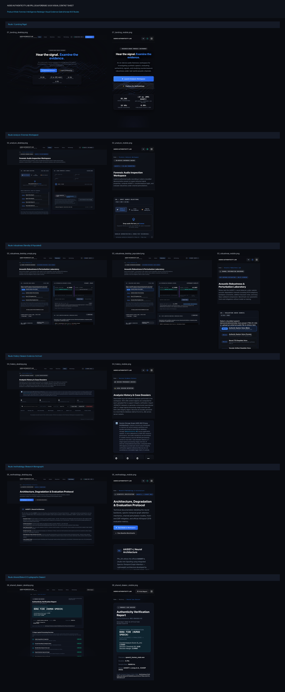

# AUDIO AUTHENTICITY LAB (PRJ_55) — UI/UX VISUAL EVIDENCE INVENTORY

This directory contains genuine, browser-rendered visual evidence capturing the
complete product-wide UI/UX transformation across all six routes of the application.

## Visual Verification Contact Sheet

---

## Route Inventory & Verification Details

### `01_landing_desktop.png`
- **View:** Route / — Landing Page (Desktop 1600px)
- **Viewport:** 1600 × 1100 px (Desktop)
- **Description:** Hero section with 3D harmonic signal sculpture, telemetry metrics, and 6-capability editorial grid.
- **Artifact Link:** [01_landing_desktop.png](01_landing_desktop.png)

### `01_landing_mobile.png`
- **View:** Route / — Landing Page (Mobile 390px)
- **Viewport:** 390 × 844 px (Mobile, Device Scale Factor 2)
- **Description:** Fully responsive mobile layout with compact status beacon, telemetry grid, and zero horizontal clipping.
- **Artifact Link:** [01_landing_mobile.png](01_landing_mobile.png)

### `02_analyze_desktop.png`
- **View:** Route /analyze — Forensic Inspection Workspace (Desktop 1600px)
- **Viewport:** 1600 × 1100 px (Desktop)
- **Description:** Dual Simple/Expert view modes, dropzone, bundled demonstration presets, and spectrogram.
- **Artifact Link:** [02_analyze_desktop.png](02_analyze_desktop.png)

### `02_analyze_mobile.png`
- **View:** Route /analyze — Forensic Inspection Workspace (Mobile 390px)
- **Viewport:** 390 × 844 px (Mobile, Device Scale Factor 2)
- **Description:** Mobile-optimized tab bar, drop zone, and stacked forensic controls.
- **Artifact Link:** [02_analyze_mobile.png](02_analyze_mobile.png)

### `03_robustness_desktop_empty.png`
- **View:** Route /robustness — Acoustic Robustness Lab [Standby State] (Desktop 1600px)
- **Viewport:** 1600 × 1100 px (Desktop)
- **Description:** Initial state awaiting experiment execution; balanced dual-column workspace.
- **Artifact Link:** [03_robustness_desktop_empty.png](03_robustness_desktop_empty.png)

### `03_robustness_desktop_populated.png`
- **View:** Route /robustness — Acoustic Robustness Lab [Populated State] (Desktop 1600px)
- **Viewport:** 1600 × 1100 px (Desktop)
- **Description:** Populated state after executing real-time perturbation experiment showing delta score and A/B comparison.
- **Artifact Link:** [03_robustness_desktop_populated.png](03_robustness_desktop_populated.png)

### `03_robustness_mobile.png`
- **View:** Route /robustness — Acoustic Robustness Lab (Mobile 390px)
- **Viewport:** 390 × 844 px (Mobile, Device Scale Factor 2)
- **Description:** Single-column mobile layout with demonstration preset cards and stacked controls.
- **Artifact Link:** [03_robustness_mobile.png](03_robustness_mobile.png)

### `04_history_desktop.png`
- **View:** Route /history — Session Evidence History (Desktop 1600px)
- **Viewport:** 1600 × 1100 px (Desktop)
- **Description:** ADR-002 storage scope banner, inference telemetry strip, and case ledger.
- **Artifact Link:** [04_history_desktop.png](04_history_desktop.png)

### `04_history_mobile.png`
- **View:** Route /history — Session Evidence History (Mobile 390px)
- **Viewport:** 390 × 844 px (Mobile, Device Scale Factor 2)
- **Description:** Mobile forensic audit trail with responsive cards and action toolbars.
- **Artifact Link:** [04_history_mobile.png](04_history_mobile.png)

### `05_methodology_desktop.png`
- **View:** Route /methodology — Architecture & Evaluation Protocol (Desktop 1600px)
- **Viewport:** 1600 × 1100 px (Desktop)
- **Description:** Technical research monograph with mathematical formulas and ASVspoof 2019 baseline comparisons.
- **Artifact Link:** [05_methodology_desktop.png](05_methodology_desktop.png)

### `05_methodology_mobile.png`
- **View:** Route /methodology — Architecture & Evaluation Protocol (Mobile 390px)
- **Viewport:** 390 × 844 px (Mobile, Device Scale Factor 2)
- **Description:** Mobile-adapted typographic hierarchy and technical monograph cards.
- **Artifact Link:** [05_methodology_mobile.png](05_methodology_mobile.png)

### `06_shared_dossier_desktop.png`
- **View:** Route /shared/{token} — Shared Forensic Case Dossier (Desktop 1600px)
- **Viewport:** 1600 × 1100 px (Desktop)
- **Description:** Public bearer link view with verdict, SHA-256 digest, and 7-stage logical processing overview.
- **Artifact Link:** [06_shared_dossier_desktop.png](06_shared_dossier_desktop.png)

### `06_shared_dossier_mobile.png`
- **View:** Route /shared/{token} — Shared Forensic Case Dossier (Mobile 390px)
- **Viewport:** 390 × 844 px (Mobile, Device Scale Factor 2)
- **Description:** Mobile evidence dossier with verified certificate badge and legal custody limits.
- **Artifact Link:** [06_shared_dossier_mobile.png](06_shared_dossier_mobile.png)
